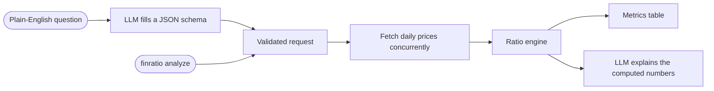

# Financial Ratio LLM

[](https://github.com/zhangyuan-nus/financial-ratio-llm/actions/workflows/ci.yml)
[](https://www.python.org/)
[](LICENSE)

Ask about risk-adjusted performance in plain English, for example *"How has a 60/40 Apple and
Microsoft portfolio done over the last two years?"*, and get Sharpe, Sortino and Treynor ratios
computed from real market data, explained by a local LLM.

The LLM never does the maths. It turns the question into a validated request, and later turns
the computed results into prose. Every number in the output comes from a deterministic,
unit-tested pandas engine, and that engine can also be run directly without the LLM.

## Example

```console
$ finratio analyze AAPL MSFT --weights 60 40 --period 2y
Portfolio: 60% AAPL, 40% MSFT
Period: 2y (2024-11-01 to 2026-10-30, 500 trading days)
Benchmark: ^GSPC | Risk-free rate: 5.00%

                   Sharpe  Sortino  Treynor  Beta   CAGR  Volatility  Max DD
Portfolio            0.75     1.13    17.0%  1.03  21.8%       23.4%  -27.8%
  AAPL               0.72     1.07    19.4%  1.07  24.2%       28.7%  -33.4%
  MSFT               0.43     0.68    13.0%  0.96  14.3%       28.8%  -34.5%
^GSPC (benchmark)    0.66     0.96    10.6%  1.00  15.4%       16.1%  -18.9%

Ratios and returns are annualized. Treynor = excess return per unit of beta.
```

The portfolio's volatility and drawdown are lower than either holding's, which lifts its Sharpe
ratio above both of them: diversification at work. Asking the same thing in plain English,
`finratio ask "Analyze my portfolio of 60% AAPL and 40% MSFT over 2 years"`, produces this table
followed by a written explanation of what the numbers mean.

## How it works



- **Structured output, not free text.** The parsing step sends Ollama a JSON schema generated
  from a Pydantic model, so the model can only answer with the expected fields. The answer is
  validated again and normalized (tickers upper-cased, weights rescaled, defaults applied)
  before any data is fetched.
- **A deterministic core.** `ratios.py` is a set of pure functions over pandas Series. Tests
  check each formula against a hand calculation, including edge cases such as zero volatility
  and assets whose trading histories don't line up.
- **A resilient data layer.** Prices for every ticker and the benchmark are fetched concurrently
  with `asyncio` and `httpx`, with a concurrency limit and exponential-backoff retries on rate
  limits and server errors. Timestamps are converted to each exchange's time zone, so series
  from different markets line up by trading date.
- **Grounded explanations.** The LLM receives the same rounded figures shown in the table and
  is instructed to use only those numbers. If it is unavailable, the table is still printed.

## Methodology

Metrics use daily simple returns of adjusted closing prices, so dividends and splits are
included, and are annualized with 252 trading days. With mean daily return $\bar r$, sample
standard deviation $\sigma$, annual risk-free rate $r_f$ and $N$ daily returns:

| Metric | Definition |
| --- | --- |
| Sharpe | $\dfrac{252\,\bar r - r_f}{\sqrt{252}\,\sigma}$ |
| Sortino | $\dfrac{252\,\bar r - r_f}{\sqrt{252}\,\mathrm{DD}}$ where $\mathrm{DD} = \sqrt{\tfrac{1}{N}\sum_{t=1}^{N} \min\left(0,\, r_t - \tfrac{r_f}{252}\right)^2}$ |
| Treynor | $\dfrac{252\,\bar r - r_f}{\beta}$ where $\beta = \dfrac{\mathrm{Cov}(r, r_m)}{\mathrm{Var}(r_m)}$ |
| CAGR | $\left(\prod_{t=1}^{N} (1 + r_t)\right)^{252/N} - 1$ |
| Max drawdown | Largest peak-to-trough fall in cumulative value |

- Downside deviation averages squared shortfalls over **all** $N$ days, not only the losing
  days. Dividing by the number of losing days is a common mistake that overstates downside risk
  and understates the Sortino ratio.
- Beta is estimated over the dates on which both the asset and the benchmark traded.
- Portfolios are rebalanced to their target weights every day, and weights are rescaled to sum
  to 100%.
- The benchmark has a beta of 1 by definition, so its Treynor ratio equals the market's excess
  return. A holding with a higher Treynor ratio earned more excess return per unit of market
  risk.

## Getting started

You need Python 3.11 or newer, a [RapidAPI key](https://rapidapi.com/apidojo/api/yahoo-finance1)
for the Yahoo Finance API, and [Ollama](https://ollama.com) for the natural-language commands.

```bash
git clone https://github.com/zhangyuan-nus/financial-ratio-llm.git
cd financial-ratio-llm
python -m venv .venv
source .venv/bin/activate        # Windows: .venv\Scripts\activate
pip install -e .
cp .env.example .env             # then add your RAPIDAPI_KEY
ollama pull llama3.1:8b          # only needed for ask and chat
```

## Usage

```bash
# Direct mode, no LLM needed
finratio analyze NVDA                                    # one stock against the S&P 500
finratio analyze AAPL MSFT GOOGL --period 5y             # side-by-side comparison
finratio analyze AAPL MSFT --weights 60 40               # a 60/40 portfolio
finratio analyze D05.SI O39.SI U11.SI --benchmark ^STI   # Singapore banks against the STI

# Natural language, requires Ollama
finratio ask "Compare the Sharpe ratios of SPY and QQQ over 5 years"
finratio ask "How risky is my portfolio of 50% TSLA, 30% AAPL and 20% GLD this year?"
finratio chat
```

Supported periods are `1mo`, `3mo`, `6mo`, `ytd`, `1y`, `2y`, `5y` and `10y`. Any Yahoo Finance
symbol works, including indices (`^GSPC`), ETFs (`SPY`) and SGX listings (`D05.SI`). Each
analysis makes one API request per ticker, plus one for the benchmark.

## Configuration

Settings are read from environment variables or a `.env` file in the working directory.

| Variable | Default | Purpose |
| --- | --- | --- |
| `RAPIDAPI_KEY` | required | Key for the Yahoo Finance API on RapidAPI |
| `OLLAMA_BASE_URL` | `http://localhost:11434` | Address of the Ollama server |
| `OLLAMA_MODEL` | `llama3.1:8b` | Ollama model used to parse questions and write explanations |
| `RISK_FREE_RATE` | `0.05` | Annual risk-free rate, as a decimal |
| `DEFAULT_BENCHMARK` | `^GSPC` | Benchmark used for beta and the Treynor ratio |
| `DEFAULT_PERIOD` | `1y` | Look-back period when none is given |

## Project structure

```text
src/finratio/
├── cli.py           # analyze, ask and chat commands
├── analyzer.py      # request validation and the analysis pipeline
├── ratios.py        # Sharpe, Sortino, Treynor, beta, CAGR and drawdown
├── portfolio.py     # weight normalization and portfolio returns
├── market_data.py   # async RapidAPI client and response parsing
├── llm.py           # Ollama: question to request, results to explanation
├── report.py        # the table, and the summary passed to the LLM
└── config.py        # settings from the environment
tests/               # offline tests with a fake price source and a fake LLM
```

## Development

```bash
pip install -e ".[dev]"
pytest
ruff check . && ruff format --check .
```

The tests need no network access or API keys. The market-data client is tested with
`httpx.MockTransport` against a recorded API response, and the LLM layer against a fake Ollama
client. CI runs the suite on Python 3.11 to 3.14.

## Limitations

- The ratios describe past performance over the chosen window. They are not forecasts.
- A constant risk-free rate is used rather than a historical Treasury bill series.
- Annualization assumes 252 trading days, which does not suit assets that trade every day,
  such as cryptocurrencies.
- Portfolios are long-only, rebalanced daily, and ignore transaction costs and taxes.

## License

[MIT](LICENSE). This project is for education and research, and is not investment advice.
